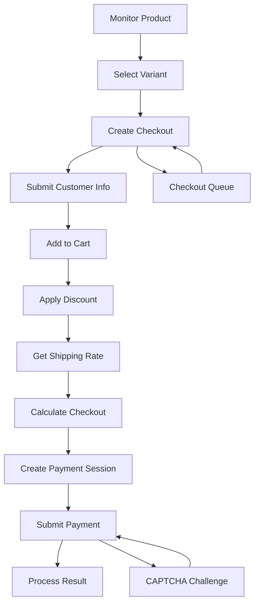

# Shopify Checkout Automation

A legacy Shopify checkout automation proof-of-concept, built while I was learning how e-commerce checkout systems actually work under the hood.

This repo is the Shopify module pulled from a larger multi-site automation project I built, which also supported Supreme and Foot Locker. It was one of my first big JavaScript projects, and it taught me a ton about REST APIs, HTTP request flows, sessions, web scraping, reverse-engineering browser behavior, proxies, and anti-bot systems.

> [!NOTE]
> This uses legacy Shopify checkout behavior and endpoints. Some of what's shown here is deprecated or no longer works the way it did when this was originally built.

## Demo

<p align="center">
  
</p>

The demo shows this module running inside the original checkout bot, working through a Shopify checkout end to end and completing a purchase within seconds.

## What It Does

The Shopify module handles most of the checkout flow programmatically, from finding a product to submitting payment:

- Product monitoring via Shopify product feeds and endpoints
- Keyword, product-link, and direct-variant monitoring
- Variant and stock detection
- Checkout creation and updates
- Customer and shipping info submission
- Shipping-rate retrieval and checkout calculation
- Discount handling
- Payment-session creation
- Checkout queue polling
- Cookie and session persistence
- Proxy support
- CAPTCHA solving via 2Captcha
- Experimental PayPal checkout flow
- Retry/polling logic for async requests

## Structure

```text
shopify/
├── modes/
│   └── fast.js
├── requests/
│   ├── ajax.js
│   ├── frontend.js
│   ├── graphql.js
│   ├── paypal.js
│   ├── storefront.js
│   └── wallets.js
├── scripts/
│   └── session.js
└── utils/
    ├── input.js
    ├── parse.js
    └── time.js

twocaptcha/
├── apis/
├── requests/
└── twocaptcha.js
```

The main checkout task is essentially a small async state machine — each step returns the next step in the flow — while the request helpers keep Shopify, PayPal, wallet, and CAPTCHA logic cleanly separated from the controller.

## Checkout Flow



## Reverse Engineering

A big chunk of this project was figuring out how checkout worked beyond what's publicly documented — inspecting network traffic, reading storefront JavaScript, comparing requests, following redirects, and reproducing parts of the flow in code. A few alternate request paths only turned up from reading Shopify's frontend checkout scripts directly, not from any docs.

Honestly, that process was probably the most valuable part of the whole project — learning how to break an unfamiliar system into smaller pieces, test assumptions, and find another way in when the obvious approach didn't pan out.

## Tech Stack

`JavaScript` · `Node.js` · `REST APIs` · `GraphQL` · `got` · `tough-cookie` · `Cheerio` · `2Captcha` · `HTTP/HTTPS Proxies` · Shopify's legacy Storefront APIs

## What I Learned

- REST APIs and HTTP request flows
- Cookies, sessions, headers, and redirects
- Web scraping and product monitoring
- Reverse-engineering browser behavior
- Reading and analyzing frontend JavaScript
- Working with undocumented API behavior
- Proxies and request routing
- Rate limits, polling, and retry logic
- Async JavaScript workflows
- Checkout and payment-session architecture
- CAPTCHA and anti-bot systems
- Queue handling

Looking back, there's plenty I'd write differently now — but that's part of why I kept this around and documented it. It's a decent snapshot of what I was learning at the time and how I approached unfamiliar systems before I had much experience with anything larger.

## Project Status

**Archived.** This repo exists as a technical record of the Shopify portion of the original bot. It's not maintained as a production-ready tool, and some dependencies, services, or endpoints may no longer work. The code has been cleaned up and documented to make the original implementation easier to follow.

## Disclaimer

Shared for educational and archival purposes only. Not intended for production use or for bypassing the rules, protections, or terms of service of any platform.

## License

MIT