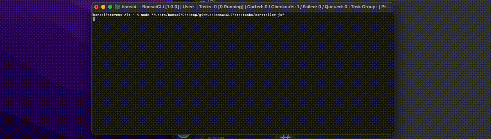
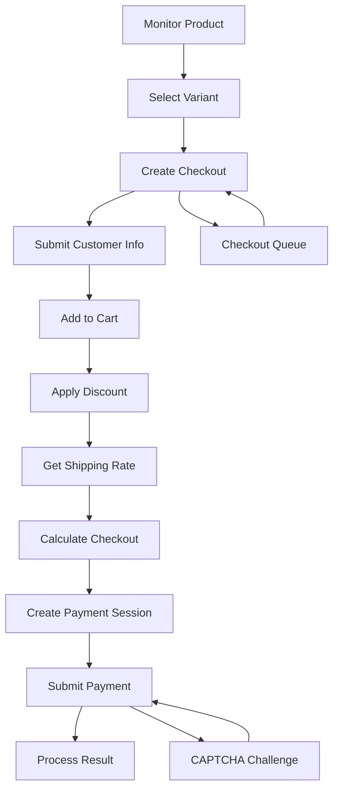

# Shopify Checkout Automation

A legacy Shopify checkout automation proof-of-concept built while I was learning how e-commerce checkout systems worked under the hood.

This repo contains the Shopify module from a larger multi-site automation project I built that also supported Supreme and Foot Locker. It was one of my first big JavaScript projects, and it taught me a lot about REST APIs, HTTP requests, sessions, web scraping, reverse engineering browser flows, proxies, and anti-bot systems.

> [!NOTE]
> This project uses legacy Shopify checkout behavior and APIs. Some endpoints and techniques shown here are deprecated or no longer work as they did when the project was originally built.

## Demo

<p align="center">
  
</p>

The demo shows this module integrated into the original checkout bot, automating the Shopify checkout flow and completing purchases within seconds.

## What it does

The Shopify module handles most of the checkout flow programmatically, from finding a product to submitting payment.

- Product monitoring through Shopify product feeds and product endpoints
- Keyword, product-link, and direct variant monitoring
- Variant and stock detection
- Checkout creation and updates
- Customer and shipping information submission
- Shipping-rate retrieval and checkout calculation
- Discount handling
- Payment-session creation
- Checkout queue polling
- Cookie and session persistence
- Proxy support
- CAPTCHA solving through 2Captcha
- Experimental PayPal checkout flow
- Retry and polling logic for asynchronous requests

## How it is structured

```text
shopify/
├── modes/
│   └── fast.js
├── requests/
│   ├── ajax.js
│   ├── frontend.js
│   ├── graphql.js
│   ├── paypal.js
│   ├── storefront.js
│   └── wallets.js
├── scripts/
│   └── session.js
└── utils/
    ├── input.js
    ├── parse.js
    └── time.js

twocaptcha/
├── apis/
├── requests/
└── twocaptcha.js
```

The main checkout task works like a small asynchronous state machine. Each step returns the next step in the checkout flow, while request helpers keep the Shopify, PayPal, wallet, and CAPTCHA logic separated from the controller.

## Checkout flow



## Reverse engineering

A big part of this project was figuring out how the checkout worked beyond the documented API.

I spent a lot of time inspecting browser network traffic, reading storefront JavaScript, comparing requests, following redirects, testing endpoints, and reproducing parts of the checkout flow with code. Some alternate request paths were discovered by looking through Shopify's frontend checkout scripts rather than through public documentation.

That process was probably the most valuable part of the project. It taught me how to break an unfamiliar system into smaller pieces, test assumptions, and find another approach when the obvious one did not work.

## What I learned

This project gave me hands-on experience with:

- REST APIs and HTTP request flows
- Cookies, sessions, headers, and redirects
- Web scraping and product monitoring
- Reverse engineering browser behavior
- Reading and analyzing frontend JavaScript
- Undocumented API behavior
- Proxies and request routing
- Rate limits, polling, and retry logic
- Async JavaScript workflows
- Checkout and payment-session architecture
- CAPTCHA and anti-bot systems
- Queue handling

Looking back, there are definitely parts I would write differently today, but that is also why I wanted to preserve and document it. It shows a lot of what I was learning at the time and how I approached problems before I had much experience with larger systems.

## Project status

**Archived**

This repo is mainly here as a technical archive of the Shopify portion of the original application. It is not maintained as a production-ready checkout tool, and some dependencies, services, and endpoints may no longer function.

The code has been cleaned up and documented to make the original implementation easier to follow.

## Tech

JavaScript, Node.js, REST APIs, GraphQL, `got`, `tough-cookie`, Cheerio, 2Captcha, HTTP/HTTPS proxies, and Shopify's legacy Storefront APIs.

## Disclaimer

This project is shared for educational and archival purposes. It is not intended for production use or for bypassing the rules, protections, or terms of service of any platform.

## License

MIT